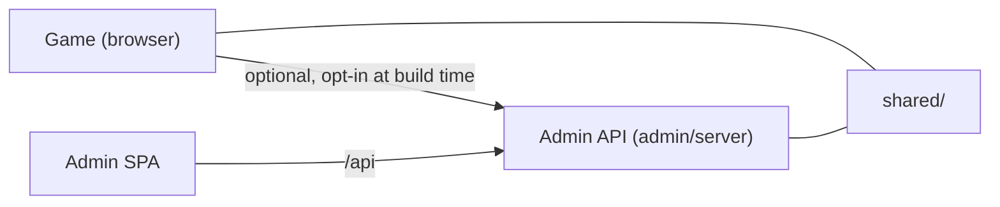

<<<<<<< Updated upstream
# draw-game
=======
# Arcane Paws: Spellscribe

A 2D browser arcade game in the style of Magic Cat Academy. You play Momo, a witch cat standing at the centre of the screen, and defend her against waves of ghosts by drawing spell gestures (strokes) on the canvas with a mouse or touch. The game UI and story are Vietnamese by default.

The repository holds three things:

| Part | Where | What it is |
| --- | --- | --- |
| Game | `main.js`, `src/`, `index.html`, `styles/` | Vanilla JavaScript, Canvas 2D and Web Audio, built with Vite into a single HTML file. Progress lives in `localStorage`. |
| Admin Control Center | `admin/` | React + TypeScript + Ant Design single-page app and a small Node HTTP API (CMS for configuration, gameplay content and story). Its own package, using npm. |
| Shared contracts | `shared/` | Validation schemas and the story engine used by both the game and the admin API. Must stay free of DOM and Node-only APIs. |



The game works fully offline. It only talks to the admin API if you build it with the `VITE_*` variables below. For a deeper walkthrough, see [docs/ai-planning/ARCHITECTURE.md](docs/ai-planning/ARCHITECTURE.md).

## Requirements

- Node.js **22.12 or newer** (`.nvmrc` pins major 22; both `package.json` files declare `engines.node >=22.12.0`)
- [pnpm](https://pnpm.io/) **10** for the game (the exact version is in the `packageManager` field)
- npm for the admin app (`admin/package-lock.json`)

## Quick start: the game

```sh
pnpm install            # run this again after pulling; node_modules is not tracked in git
pnpm dev                # Vite dev server, http://localhost:5173 by default
```

Vite moves to the next free port if 5173 is taken. To pin one, use `pnpm dev --port 5320 --strictPort`.

Build:

```sh
npx vite build --outDir "$(mktemp -d)" --emptyOutDir   # safe check: output goes to a temp folder
npm run build                                          # vite build + standalone export (see below)
```

`npm run build` writes `dist/` and also `arcane-paws-standalone.html` at the repository root. All three files are **tracked in git** for now, so only run it when you intend to commit refreshed artifacts together with the source change. To check that a build works without touching them, use the first command.

The standalone file is one self-contained HTML page; opening it directly (`file://`) is supported. In that mode the local audio and sprite files from `public/` are not loaded (observed in Chrome), so the game falls back to synthesised sound and a vector-drawn Momo. Which assets the standalone file should carry is an open product decision (DEC-09 in the plan).

## Quick start: the admin app

Full details are in [admin/README.md](admin/README.md). In short:

```sh
cd admin
npm ci
cp .env.example .env      # then set ADMIN_EMAIL and a unique ADMIN_PASSWORD (16+ characters)
npm run server            # API on 127.0.0.1:3001; in a second terminal: npm run dev
```

Never commit `.env`. The root `.gitignore` ignores `.env` and `.env.*` but keeps `.env.example`.

## Environment variables

**Game** (build time, read by Vite from `import.meta.env`; they contain no secrets). All are optional.

| Variable | Default | Purpose |
| --- | --- | --- |
| `VITE_GAME_CONFIG_URL` | unset (no remote config) | Public endpoint to fetch published game configuration from, e.g. `/api/game-config/production`. |
| `VITE_GAME_CONFIG_ENV` | unset | Name of the configuration environment to request, e.g. `production`. |
| `VITE_STORY_CONTENT_URL` | unset (bundled story) | Endpoint for published story content, e.g. `/api/story-content/published`. |
| `VITE_STORY_LOCALE` | `vi` | Story and dialogue language; `en` selects English. |
| `VITE_LIVEOPS_URL` | unset (no live operations) | Public endpoint for the live schedule (daily and weekly challenges, seasonal and random events, flags), e.g. `/api/game-liveops/production`. |
| `VITE_LIVEOPS_ENV` | `VITE_GAME_CONFIG_ENV` | Name of the live-operations environment the payload must carry, e.g. `production`. |

If a URL is unset, or loading fails validation or the network, the game keeps its bundled behaviour. Details: [docs/configuration-management.md](docs/configuration-management.md), [docs/story-cms.md](docs/story-cms.md) and [docs/live-operations.md](docs/live-operations.md).

**Admin API** (server environment, normally from `admin/.env`).

| Variable | Default | Purpose |
| --- | --- | --- |
| `ADMIN_EMAIL` | none | Login email of the single provisioned account. |
| `ADMIN_PASSWORD` | none | Its password. Choose a unique value of 16+ characters. |
| `ADMIN_PORT` | `3001` | Loopback port of the API. If you change it, update the Vite proxy target in `admin/` too. |
| `ADMIN_ROLE` | `Super Admin` | Role of that account: Super Admin, Game Designer, Content Editor, Analyst or Support. |

## Scripts

Root (`package.json`):

| Script | What it does |
| --- | --- |
| `pnpm dev` | Vite dev server for the game |
| `npm run build` / `npm run export` | `vite build`, then write the standalone HTML (updates tracked files, see above) |
| `npm run preview` | Serve the built `dist/` locally |
| `npm test` | Run every game test suite through `scripts/run-tests.mjs` |
| `npm run test:admin` | Admin backend tests (`node --test`) and UI tests (`vitest`) |
| `npm run test:all` | `npm test` and then `npm run test:admin` |
| `npm run test:combat`, `test:gestures`, `test:story` | A single area of tests |
| `npm run evaluate:gestures` | Gesture recognition evaluation (see [docs/gesture-recognition-report.md](docs/gesture-recognition-report.md)) |

Admin scripts (`admin/package.json`): `dev`, `server`, `server:start`, `build`, `preview`, `test`, `test:ui`, `format`.

## Testing

```sh
npm test                # all game suites; exits non-zero if any suite fails
npm run test:admin      # admin backend and UI tests
```

`npm test` is a sequential runner, not a plain `&&` chain. It reads `tests/manifest.json` and runs every suite. A suite fails if it exits non-zero, or if its output contains a line such as `1 Failed` or `❌ FAIL`. A test file that is not listed in the manifest also fails the run, so register new suites there. Suites known to be outdated are listed as *quarantined* and skipped; run them with `npm test -- --include-quarantine`.

## Project layout

```text
main.js                 Entry point: boots the game, loads optional remote config and story
index.html, styles/     Page shell and CSS
src/
  core/                 Game (loop and flow), state machine, constants, settings, saves and progress,
                        achievements, story director, remote configuration
  combat/               Combat resolution and status effects
  entities/             Player (Momo), enemies (ghosts, bosses), projectiles, rune patterns
  systems/              Waves, events, input, sound and audio, particles, background, quality
  ui/                   HUD, menus, story canvas, character portraits, share cards, meta screens
  GestureEngine.js      Stroke recognition
shared/                 Contracts shared by game and admin API (strict schemas)
admin/                  Admin Control Center (own package.json, see admin/README.md)
public/                 Audio and sprite files copied into the build
scripts/                Test runner, standalone bundle export, gesture evaluation, story migration,
                        and some test suites (scripts/test-*.js)
tests/                  Runner manifest and newer test suites
test-*.js               Older test suites at the repository root (registered in tests/manifest.json)
dist/, arcane-paws-standalone.html   Tracked build output
docs/                   Documentation (below)
```

## Documentation

| File | Topic |
| --- | --- |
| [docs/GDD.md](docs/GDD.md) | Game design document (Vietnamese) |
| [docs/combat.md](docs/combat.md) | Combat refactor |
| [docs/configuration-management.md](docs/configuration-management.md) | Game configuration management and remote configuration |
| [docs/gameplay-content-editors.md](docs/gameplay-content-editors.md) | Gameplay content studio |
| [docs/story-cms.md](docs/story-cms.md) | Story and dialogue CMS |
| [docs/live-operations.md](docs/live-operations.md) | Live operations: daily and weekly challenges, events, rewards, feature flags, offline behaviour |
| [docs/gesture-recognition-report.md](docs/gesture-recognition-report.md) | Gesture recognition evaluation |
| [docs/ai-planning/](docs/ai-planning/) | Roadmap, backlog and sprint plan (Vietnamese); `tasks.json` is the source of truth |

## Contributing

- Read [docs/ai-planning/EXECUTION_RULES.md](docs/ai-planning/EXECUTION_RULES.md) first. It lists the project's pitfalls (test mock contexts, the CMS-text-never-in-`innerHTML` rule, canvas path handling and more) and the Git and approval rules.
- Run `npm test` and `npm run test:admin` before opening a pull request. Do not delete, skip or loosen a test to make it pass; a regression test for a bug must fail on the old code.
- Keep the generated plan files in sync: `node docs/ai-planning/tools/plan.mjs validate`.
- Commit messages follow Conventional Commits and name the task ID, for example `fix(admin): decode request body once (ADM-01)`.
>>>>>>> Stashed changes
