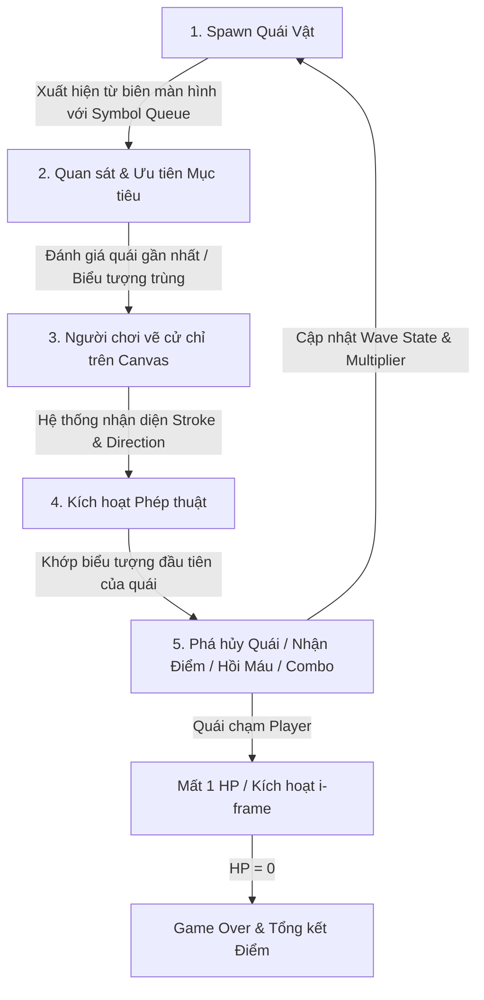
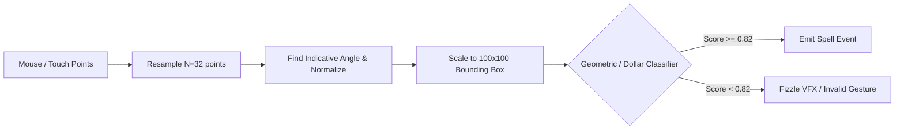

# GAME DESIGN DOCUMENT (GDD)
# Dự án: ARCANE PAWS: SPELLSCRIBE (Tựa phong cách Magic Cat Academy)
**Tác giả:** Lead Game Designer  
**Phiên bản:** 1.0.0  
**Nền tảng:** Web Browser (HTML5 Canvas / WebGL, hỗ trợ Mouse & Touch)  
**Thể loại:** 2D Arcade / Gesture-Drawing / Wave Defense  
**Đối tượng mục tiêu:** Casual & Mid-core players, thích phản xạ nhanh và cơ chế vẽ cử chỉ (gesture tracing).

---

## 1. TỔNG QUAN DỰ ÁN & CORE LOOP

### 1.1. Khái niệm cốt lõi (Game Concept)
Người chơi điều khiển một Chú Mèo Phù Thủy (Momo / Arcane Cat) đứng ở vị trí cố định tại trung tâm màn hình. Các đợt linh hồn ma quỷ (Ghost Spirits) liên tục tiến về phía trung tâm từ mọi hướng, mang trên đầu các ký hiệu ma thuật (Runes). Người chơi phải dùng chuột hoặc ngón tay vẽ các nét cử chỉ tương ứng trên màn hình để tung phép giải trừ quái vật trước khi chúng tiếp cận và gây sát thương.

### 1.2. Vòng lặp Gameplay Chính (Core Loop)

Vòng lặp trải nghiệm người chơi diễn ra liên tục theo chu trình 5 bước sau:



#### Phân tích chi tiết từng pha:
1. **Spawn Quái (Spawning Phase):**
   - Quái vật xuất hiện từ rìa màn hình (Left, Right, Top, Bottom) theo quy luật của từng Wave.
   - Mỗi quái vật có một hàng đợi biểu tượng (`Symbol Queue`) hiển thị trên đỉnh đầu. Biểu tượng ngoài cùng bên trái (hoặc biểu tượng active) là điều kiện cần triệt tiêu tiếp theo.
2. **Quan sát & Đánh giá (Perception & Prioritization):**
   - Người chơi đọc tín hiệu thị giác: vị trí quái, khoảng cách tới chú mèo (Danger Zone), loại quái (bay nhanh, bọc thép) và loại biểu tượng chung trên nhiều quái.
3. **Vẽ Cử chỉ (Input & Tracing Phase):**
   - Người chơi giữ chuột trái hoặc ngón tay trên màn hình và kéo nét vẽ.
   - Hệ thống render đường vệt sáng phép thuật (Arcane Trail / Particle Emitter) phản hồi xúc giác thị giác lập tức.
   - Khi nhả chuột/tay (`pointerup`), hệ thống gửi chuỗi tọa độ `Vector2[]` đến module **Gesture Recognizer**.
4. **Phân giải Phép thuật (Spell Dispatch Phase):**
   - Gesture Recognizer phân tích nét vẽ theo tập mẫu (Template Matching).
   - Nếu nét vẽ hợp lệ, game phát âm thanh phép thuật (SFX), kích hoạt hoạt ảnh mèo vung đũa phép (Wand Cast Animation), và bắn ra projectile hoặc hiệu ứng sóng năng lượng tương ứng.
   - Tất cả quái vật có biểu tượng đầu tiên khớp với nét vẽ sẽ bị xóa biểu tượng đó khỏi queue.
5. **Đạt kết quả & Phản hồi (Resolution & Feedback Loop):**
   - Khi `Symbol Queue` của quái cạn: Quái bị thanh tẩy (Poof VFX + Drop Soul Mote), cộng điểm cơ bản, gia tăng thanh Combo.
   - Nếu quái mang ấn ký hồi máu (❤️): Kích hoạt hồi HP.
   - Nếu quái chạm vòng va chạm của Mèo: Gây sát thương -1 HP, rung màn hình (Screen Shake), kích hoạt 1 giây bất tử tạm thời (Invulnerability Frame).

---

## 2. DANH MỤC BIỂU TƯỢNG (SYMBOL ROSTER) & CƠ CHẾ PHÉP THUẬT

Hệ thống biểu tượng được thiết kế với tiêu chí: **Trực quan, phân biệt rõ phương vị (Directionality), và độ trễ nhận diện cực thấp (<16ms)**.

| STT | Ký hiệu | Tên phép | Quy tắc vẽ (Gesture Definition) | Cơ chế Gameplay | VFX & Âm thanh |
|:---:|:---:|:---|:---|:---|:---|
| **1** | **—** | **Arcane Slash** *(Nét ngang)* | Kéo ngang từ Trái sang Phải hoặc Phải sang Trái (Độ lệch góc $\le 20^\circ$). Chiều dài tối thiểu 60px. | **Sát thương Diện rộng (AoE Cleave):** Xóa biểu tượng (—) của TẤT CẢ quái vật đang có biểu tượng này ở đầu queue trên toàn màn hình cùng lúc. | Vệt sáng lưỡi kiếm vàng cắt ngang màn hình. Tiếng kiếm chém ma thuật vút qua không khí (*Whoosh-slash*). |
| **2** | **\|** | **Piercing Bolt** *(Nét dọc)* | Kéo thẳng từ Trên xuống Dưới (hoặc Dưới lên Trên, độ lệch góc $\le 20^\circ$). Chiều dài tối thiểu 60px. | **Xuyên thấu (Piercing Lance):** Ưu tiên xuyên thẳng qua hàng quái theo hướng vẽ, gây hiệu ứng phá giáp nhanh hơn cho quái bọc thép. | Tia sét/mũi giáo thần thánh xanh lam bắn thẳng. Âm thanh tia laser cô đọng (*Zap-crackle*). |
| **3** | **∧** | **Apex Inversion** *(Góc nhọn lên)* | Vẽ nét đi lên rồi bẻ góc đi xuống ($\approx 45^\circ - 70^\circ$). 1 nét liền không nhấc tay. | **Combo Starter / Disruption:** Tiêu diệt ấn ký (∧). Nếu vẽ tiếp nối (∨) trong vòng 1.5s sẽ tạo ra đợt sóng xung kích đẩy lùi (Knockback 40px) toàn bộ quái vật xung quanh. | Vệt lửa ma pháp màu đỏ cam bung nở hình nón hướng lên. Tiếng chuông cộng hưởng trầm. |
| **4** | **∨** | **Abyss Inversion** *(Góc nhọn xuống)* | Vẽ nét đi xuống rồi bẻ góc đi lên. 1 nét liền không nhấc tay. | **Combo Finisher / Gravity:** Tiêu diệt ấn ký (∨). Khi kết hợp hoàn tất chuỗi ∧ + ∨ hoặc ∨ + ∧: Tặng ngay +50% điểm combo và làm chậm (Slow 30%) toàn sàn đấu trong 2s. | Vệt năng lượng tím thẫm tụ lực xuống dưới. Tiếng vỡ vụn của pha lê (*Crystalline Shatter*). |
| **5** | **⚡** | **Overload Chain** *(Tia sét)* | Vẽ nét zic-zac (Z-shape hoặc 3 đoạn gấp khúc nhọn). | **Kích nổ Dây chuyền (Screen Detonation):** Kích nổ lập tức TOÀN BỘ quái vật mang biểu tượng này trên màn hình (bất kể vị trí trong queue). Quái nổ tạo sát thương lan 100px xung quanh. | Luồng điện cao thế xanh ngọc giật sáng chói toàn màn hình (Flash 0.1s). Âm thanh sấm sét nổ rền (*Thunder strike*). |
| **6** | **❤️** | **Purifying Heart** *(Trái tim)* | Vẽ 2 cung tròn khép đáy nhọn (hoặc dạng chữ 'V' tròn cánh / nét trái tim liên tục). | **Hồi phục Sinh mệnh (Soul Heal):** Hồi +1 HP ngay lập tức (không vượt quá Max HP = 5). Biểu tượng thường xuất hiện ở cuối chuỗi của Quái Tốc Độ hoặc Quái Bọc Thép. | Hào quang ánh sáng hồng ngọc bao bọc Mèo Phù Thủy, bong bóng trái tim bay lên. Âm thanh chuông thần tiên ấm áp (*Chime heal*). |

---

## 3. CƠ CHẾ QUÁI VẬT & MÔ HÌNH ĐỘ KHÓ (ENEMY & DIFFICULTY SCALING)

### 3.1. Phân loại Quái vật (Enemy Archetypes)

```
        [Player - Central Cat]
                 ^
                 | 
   (Speedster)  / \  (Armored: [—][|][⚡])
     [❤️]       /   \
               /     \
         (Regular: [—][∧])
```

1. **Quái Thường (Ghostling / Wisp):**
   - **Đặc điểm:** Linh hồn trắng bay lơ lửng, quỹ đạo thẳng tắp hoặc hơi uốn lượn nhẹ về phía Player.
   - **Số biểu tượng:** 1 đến 2 biểu tượng ngẫu nhiên (`—`, `|`, `∧`, `∨`).
   - **Tốc độ di chuyển:** $v = 90 - 120\text{ px/s}$.
   - **Vai trò:** Mục tiêu cơ bản, dùng để duy trì nhịp combo của người chơi.

2. **Quái Tốc Độ (Phantom Dart / Blink Bat):**
   - **Đặc điểm:** Kích thước nhỏ hơn 30%, có đuôi khói đen hoặc dơi ma quái. Di chuyển theo đường gấp khúc hoặc gia tốc lao nhanh về trung tâm.
   - **Số biểu tượng:** Đúng 1 biểu tượng duy nhất (có xác suất 20% là biểu tượng ❤️ nếu Player đang mất máu).
   - **Tốc độ di chuyển:** $v = 220 - 280\text{ px/s}$ (gấp 2.5 lần quái thường).
   - **Vai trò:** Phá vỡ sự tập trung, buộc người chơi phải ưu tiên giải quyết ngay lập tức (Priority Threat).

3. **Quái Bọc Thép (Wraith Knight / Golem Spirit):**
   - **Đặc điểm:** Thể tích lớn gấp đôi, mang giáp đầu lâu hoặc vòng khiên ma thuật.
   - **Số biểu tượng:** 3 đến 5 biểu tượng xếp hàng ngang liên tiếp (VD: `[—] -> [|] -> [∧] -> [⚡]`).
   - **Tốc độ di chuyển:** $v = 45 - 65\text{ px/s}$ (chậm nhưng tạo áp lực tâm lý diện rộng).
   - **Vai trò:** "Bức tường thịt" (Damage sponge), buộc người chơi phải thực hiện chuỗi combo chuẩn xác dưới áp lực thời gian.

---

### 3.2. Công thức Toán học Tính toán Độ Khó theo Wave

Mỗi màn chơi chia thành các Wave ($W = 1, 2, 3, \dots, n$). Độ khó được kiểm soát chặt chẽ bằng hàm toán học để tránh trường hợp người chơi bị quá tải hoặc quá nhàm chán.

#### A. Tổng số quái vật mỗi Wave ($N_{total}$)
Số lượng quái tăng dần theo hàm lũy thừa dưới tuyến tính nhằm tăng độ dài wave mà không làm kiệt sức người chơi:

$$N_{total}(W) = \left\lfloor 8 + 4 \cdot W^{1.18} \right\rfloor$$

- *Wave 1:* $8 + 4 \cdot 1 = 12$ quái.
- *Wave 2:* $8 + 4 \cdot 2.26 \approx 17$ quái.
- *Wave 3:* $8 + 4 \cdot 3.65 \approx 22$ quái.
- *Wave 5:* $8 + 4 \cdot 6.67 \approx 34$ quái.
- *Wave 10:* $8 + 4 \cdot 15.13 \approx 68$ quái.

#### B. Khoảng thời gian Spawn giữa 2 quái liên tiếp ($I_{spawn}$ - tính bằng giây)
Thời gian hồi giữa 2 lần spawn giảm dần theo hàm mũ âm tiệm cận về ngưỡng phản xạ cực hạn của con người:

$$I_{spawn}(W) = \max\left(0.55, \; 2.6 \cdot e^{-0.09 \cdot (W - 1)}\right)$$

- *Wave 1:* $2.60\text{s}$ (rất thoải mái để học vẽ).
- *Wave 3:* $2.6 \cdot e^{-0.18} \approx 2.17\text{s}$.
- *Wave 5:* $2.6 \cdot e^{-0.36} \approx 1.81\text{s}$.
- *Wave 10:* $2.6 \cdot e^{-0.81} \approx 1.15\text{s}$.
- *Wave 15+:* Chạm trần tiệm cận $0.55\text{s}$ (nhịp độ điên cuồng).

#### C. Hệ số Tốc độ Di chuyển ($SpeedMultiplier$)

$$S_{mult}(W) = \min\left(1.75, \; 1.0 + 0.05 \cdot (W - 1)\right)$$

Mỗi wave quái bay nhanh hơn 5%, tối đa không quá 175% tốc độ gốc để đảm bảo nét vẽ của người chơi vẫn có cơ hội trúng đích.

#### D. Ma trận Phân bổ Loại Quái theo Wave (Spawn Weight Distribution)

| Wave ($W$) | Quái Thường (Regular) | Quái Tốc Độ (Speedster) | Quái Bọc Thép (Armored) | Xác suất xuất hiện Quái Tim (❤️) |
|:---|:---:|:---:|:---:|:---:|
| **Wave 1** | 100% | 0% | 0% | 0% |
| **Wave 2** | 85% | 15% | 0% | 5% (nếu mất máu) |
| **Wave 3 - 4** | 65% | 25% | 10% | 8% |
| **Wave 5 - 7** | 45% | 35% | 20% | 12% |
| **Wave 8+** | 35% | 40% | 25% | 15% |

#### E. Cơ chế Dynamic Difficulty Adjustment (DDA - Tự cân bằng độ khó)
- **Nếu Player HP $\le 2$:**
  - Giảm $I_{spawn}$ tạm thời 15% (quái ra thưa hơn).
  - Tăng xác suất spawn quái mang biểu tượng ❤️ lên $+20\%$.
- **Nếu Player duy trì Combo $\ge 15$:**
  - Tăng tốc độ bay của đợt quái tiếp theo $+10\%$ để tạo cảm giác hưng phấn (Flow State).

---

## 4. HỆ THỐNG ĐIỂM SỐ & COMBO (SCORING & COMBO SYSTEM)

### 4.1. Công thức Tính Điểm
Điểm nhận được khi triệt tiêu 1 biểu tượng $S$ trên quái:

$$\text{Score}(S) = \text{BasePoints}(S) \times \text{ComboMultiplier}$$

- **BasePoints:**
  - Nét cơ bản (`—`, `|`): $100\text{ pts}$
  - Nét combo (`∧`, `∨`): $150\text{ pts}$
  - Nét sấm sét (`⚡`): $300\text{ pts} + 50\text{ pts}$ cho mỗi quái nổ kèm.
  - Phá huỷ hoàn toàn Quái Bọc Thép: Thưởng thêm $+500\text{ pts}$.
  - Hồi máu (`❤️`): $200\text{ pts}$.

### 4.2. Cơ chế Combo Multiplier
- Mỗi nét vẽ chính xác không đứt quãng: Tăng `ComboCount` thêm $+1$.
- `ComboMultiplier` tính theo bậc thang:
  - Combo 1 - 4: **x1**
  - Combo 5 - 9: **x2**
  - Combo 10 - 19: **x3**
  - Combo 20 - 34: **x4**
  - Combo 35+: **x5 (MAX)**
- **Combo Decay (Hao mòn combo):** 
  - Sau mỗi nét vẽ trúng, đồng hồ đếm ngược có thời lượng $T_{decay} = 2.2\text{s}$.
  - Nếu hết thời gian mà người chơi chưa vẽ trúng nét tiếp theo, hoặc người chơi vẽ nét sai không trúng bất kỳ quái nào: Combo reset về $0$, Multiplier trở về **x1**.

---

## 5. THIẾT KẾ DATA SCHEMA (JSON DATA SPECIFICATION)

Dưới đây là đặc tả cấu trúc dữ liệu chuẩn JSON sẵn sàng tích hợp trực tiếp vào hệ thống runtime của game (TypeScript / JavaScript).

### 5.1. Wave Configuration Schema (`WaveConfig`)
Đặc tả thông số của một Wave cụ thể, cho phép thiết kế level linh hoạt theo kịch bản (data-driven design).

```json
{
  "$schema": "http://json-schema.org/draft-07/schema#",
  "title": "WaveConfig",
  "type": "object",
  "properties": {
    "waveNumber": {
      "type": "integer",
      "minimum": 1,
      "description": "Số thứ tự của Wave"
    },
    "waveDurationLimitSeconds": {
      "type": "number",
      "description": "Thời gian tối đa để hoàn thành Wave trước khi ép spawn toàn bộ"
    },
    "totalEnemyCount": {
      "type": "integer",
      "minimum": 1
    },
    "baseSpawnIntervalSeconds": {
      "type": "number",
      "minimum": 0.3
    },
    "speedMultiplier": {
      "type": "number",
      "default": 1.0
    },
    "archetypeDistribution": {
      "type": "object",
      "properties": {
        "regular_ghost": { "type": "number", "minimum": 0, "maximum": 1 },
        "speedster_bat": { "type": "number", "minimum": 0, "maximum": 1 },
        "armored_wraith": { "type": "number", "minimum": 0, "maximum": 1 }
      },
      "required": ["regular_ghost", "speedster_bat", "armored_wraith"]
    },
    "heartDropChance": {
      "type": "number",
      "minimum": 0,
      "maximum": 1,
      "description": "Tỉ lệ chèn biểu tượng Heart vào quái"
    },
    "intermissionDelaySeconds": {
      "type": "number",
      "default": 3.0,
      "description": "Thời gian nghỉ giữa wave hiện tại và wave tiếp theo"
    }
  },
  "required": ["waveNumber", "totalEnemyCount", "baseSpawnIntervalSeconds", "archetypeDistribution"]
}
```

#### Ví dụ JSON Instance cho Wave 3:
```json
{
  "waveNumber": 3,
  "waveDurationLimitSeconds": 45.0,
  "totalEnemyCount": 22,
  "baseSpawnIntervalSeconds": 2.15,
  "speedMultiplier": 1.10,
  "archetypeDistribution": {
    "regular_ghost": 0.65,
    "speedster_bat": 0.25,
    "armored_wraith": 0.10
  },
  "heartDropChance": 0.08,
  "intermissionDelaySeconds": 3.5
}
```

---

### 5.2. Enemy Template Schema (`EnemyTemplate`)
Đặc tả thuộc tính của một loại quái vật mẫu trong hệ thống Registry.

```json
{
  "$schema": "http://json-schema.org/draft-07/schema#",
  "title": "EnemyTemplate",
  "type": "object",
  "properties": {
    "id": {
      "type": "string",
      "description": "Mã định danh duy nhất của Template"
    },
    "displayName": {
      "type": "string"
    },
    "category": {
      "type": "string",
      "enum": ["REGULAR", "SPEEDSTER", "ARMORED", "BOSS"]
    },
    "baseSpeedPixelsPerSec": {
      "type": "number",
      "minimum": 10
    },
    "movementPattern": {
      "type": "string",
      "enum": ["DIRECT_HOMING", "SINUSOIDAL", "ZIGZAG_DASH", "ORBITAL"]
    },
    "hitboxRadiusPixels": {
      "type": "number",
      "default": 24.0
    },
    "symbolPool": {
      "type": "array",
      "items": {
        "type": "string",
        "enum": ["HORIZONTAL", "VERTICAL", "CHEVRON_UP", "CHEVRON_DOWN", "LIGHTNING", "HEART"]
      }
    },
    "symbolSequenceLength": {
      "type": "object",
      "properties": {
        "min": { "type": "integer", "minimum": 1 },
        "max": { "type": "integer", "minimum": 1 }
      },
      "required": ["min", "max"]
    },
    "scoreRewardOnDefeat": {
      "type": "integer",
      "minimum": 0
    },
    "visualAssets": {
      "type": "object",
      "properties": {
        "spriteSheetKey": { "type": "string" },
        "spawnAnimation": { "type": "string" },
        "deathVfxKey": { "type": "string" }
      },
      "required": ["spriteSheetKey", "deathVfxKey"]
    }
  },
  "required": ["id", "displayName", "category", "baseSpeedPixelsPerSec", "movementPattern", "symbolPool", "symbolSequenceLength", "scoreRewardOnDefeat"]
}
```

#### Ví dụ JSON Instance cho Quái Bọc Thép (Armored Wraith):
```json
{
  "id": "armored_wraith",
  "displayName": "Linh Hồn Hắc Giáp",
  "category": "ARMORED",
  "baseSpeedPixelsPerSec": 50.0,
  "movementPattern": "DIRECT_HOMING",
  "hitboxRadiusPixels": 38.0,
  "symbolPool": ["HORIZONTAL", "VERTICAL", "CHEVRON_UP", "CHEVRON_DOWN", "LIGHTNING"],
  "symbolSequenceLength": {
    "min": 3,
    "max": 5
  },
  "scoreRewardOnDefeat": 500,
  "visualAssets": {
    "spriteSheetKey": "spr_wraith_knight",
    "spawnAnimation": "anim_wraith_portal",
    "deathVfxKey": "vfx_armor_burst"
  }
}
```

---

### 5.3. Player Runtime State Schema (`PlayerState`)
Đặc tả trạng thái thời gian thực của người chơi được lưu trữ trong State Manager trong suốt phiên chơi.

```json
{
  "$schema": "http://json-schema.org/draft-07/schema#",
  "title": "PlayerState",
  "type": "object",
  "properties": {
    "currentHP": {
      "type": "integer",
      "minimum": 0
    },
    "maxHP": {
      "type": "integer",
      "default": 5
    },
    "score": {
      "type": "integer",
      "minimum": 0
    },
    "highScore": {
      "type": "integer",
      "minimum": 0
    },
    "comboCount": {
      "type": "integer",
      "minimum": 0
    },
    "comboMultiplier": {
      "type": "number",
      "minimum": 1.0,
      "maximum": 5.0
    },
    "comboDecayRemainingSeconds": {
      "type": "number",
      "minimum": 0
    },
    "isInvulnerable": {
      "type": "boolean",
      "description": "Trạng thái i-frame sau khi bị va chạm"
    },
    "invulnerableTimeRemaining": {
      "type": "number",
      "minimum": 0
    },
    "activeCombos": {
      "type": "array",
      "items": {
        "type": "object",
        "properties": {
          "comboName": { "type": "string" },
          "expiresAtTimestamp": { "type": "number" },
          "buffEffect": { "type": "string" }
        },
        "required": ["comboName", "expiresAtTimestamp", "buffEffect"]
      }
    },
    "metrics": {
      "type": "object",
      "properties": {
        "spellsCast": { "type": "integer" },
        "spellsHit": { "type": "integer" },
        "accuracyRate": { "type": "number", "minimum": 0, "maximum": 1 },
        "damageTaken": { "type": "integer" },
        "totalHealed": { "type": "integer" }
      },
      "required": ["spellsCast", "spellsHit", "accuracyRate", "damageTaken", "totalHealed"]
    }
  },
  "required": ["currentHP", "maxHP", "score", "comboCount", "comboMultiplier", "isInvulnerable", "activeCombos", "metrics"]
}
```

#### Ví dụ JSON Instance Runtime State trong trận đấu:
```json
{
  "currentHP": 4,
  "maxHP": 5,
  "score": 14850,
  "highScore": 32000,
  "comboCount": 18,
  "comboMultiplier": 3.0,
  "comboDecayRemainingSeconds": 1.85,
  "isInvulnerable": false,
  "invulnerableTimeRemaining": 0.0,
  "activeCombos": [
    {
      "comboName": "ARCANE_SHOCKWAVE_SLOW",
      "expiresAtTimestamp": 1793444850123,
      "buffEffect": "ENEMY_SLOW_30_PERCENT"
    }
  ],
  "metrics": {
    "spellsCast": 64,
    "spellsHit": 61,
    "accuracyRate": 0.953,
    "damageTaken": 1,
    "totalHealed": 1
  }
}
```

---

## 6. THUẬT TOÁN NHẬN DIỆN CỬ CHỈ (GESTURE RECOGNITION ARCHITECTURE)

Nhằm tối ưu cho Web Game chạy mượt mà 60 FPS trên cả mobile và desktop, kiến trúc đề xuất sử dụng kết hợp giữa **$1 Unistroke Recognizer (Dollar Recognizer)** và **Heuristic Geometric Classifier**:



### Các tiêu chí phân loại Heuristic tốc độ cao:
1. **Horizontal Line (—):**
   - $\frac{\text{BoundingBox.Width}}{\text{BoundingBox.Height}} \ge 2.5$
   - $|\Delta Y| \le 0.35 \times \text{BoundingBox.Width}$
2. **Vertical Line (|):**
   - $\frac{\text{BoundingBox.Height}}{\text{BoundingBox.Width}} \ge 2.5$
   - $|\Delta X| \le 0.35 \times \text{BoundingBox.Height}$
3. **Chevron Up (∧):**
   - Bắt đầu ở nửa dưới, điểm cực trị đỉnh (Peak Y) ở khoảng giữa, kết thúc ở nửa dưới.
   - Góc đỉnh nhọn $\theta \in [35^\circ, 85^\circ]$.
4. **Chevron Down (∨):**
   - Bắt đầu ở nửa trên, điểm đáy sâu nhất ở khoảng giữa, kết thúc ở nửa trên.
5. **Lightning (⚡):**
   - Tối thiểu 2 điểm đổi hướng (Inflection points) trên trục X/Y, dạng zic-zac có độ lệch sắc nét.
6. **Heart (❤️):**
   - 2 cung tròn ở phần trên, khép góc nhọn ở đáy.

---

## 7. ĐẶC TẢ GIAO DIỆN & TRẢI NGHIỆM NGƯỜI DÙNG (UI/UX SPEC)

### 7.1. Bố cục Màn hình (Screen HUD)
- **Góc trên bên trái:** Thanh HP (5 biểu tượng Quả cầu Linh hồn / Trái tim phát sáng màu hồng tím). Khi mất máu, quả cầu vỡ vụn.
- **Chính giữa phía trên:** Chỉ số Điểm số (Score Counter) hiệu ứng số nhảy mượt mà (Lerp counter) và Bảng thông báo Wave (`WAVE 3/10`).
- **Góc trên bên phải:** Thanh Đồng hồ Combo (`COMBO x3` cùng thanh đo thời gian đếm ngược 2.2s màu dạ quang).
- **Khu vực trung tâm:** Chú Mèo Phù Thủy với các animation: `Idle`, `Draw_Charge`, `Cast_Success`, `Hurt_Stun`.
- **Lớp phủ Drawing Canvas (Canvas Overlay):** 
  - Vệt vẽ bằng hạt ma thuật (Neon Magic Ink Trail), tỏa ánh sáng neon glow (`ctx.shadowBlur = 12`).
  - Hạt bụi phép thuật lấp lánh (Sparkle particles) rơi dần sau khi ngón tay lướt qua.

### 7.2. Tín hiệu Phản hồi Cận kề Nguy hiểm (Juice & Polish)
- **Vòng nguy hiểm (Danger Radius Ring):** Một vòng sáng bán kính 120px mờ ảo quanh Mèo. Khi có bất kỳ quái nào tiến vào vòng này, vòng đổi sang màu đỏ nhấp nháy báo động.
- **Slow-motion khi cận kề nguy hiểm:** Khi quái bọc thép chỉ còn cách Player 40px, thời gian làm chậm nhẹ 20% trong 0.3s để người chơi có khoảnh khắc "Hero Save" tung nét vẽ quyết định.

---
**Tài liệu được phê duyệt bởi:** Lead Game Designer  
**Trạng thái bàn giao:** Sẵn sàng cho Team Frontend (Pixi.js / Phaser / Raw HTML5 Canvas) và Game Artist triển khai Prototype Slice 1.
