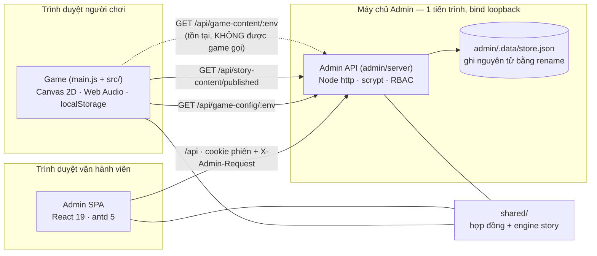
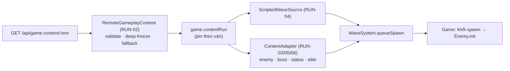
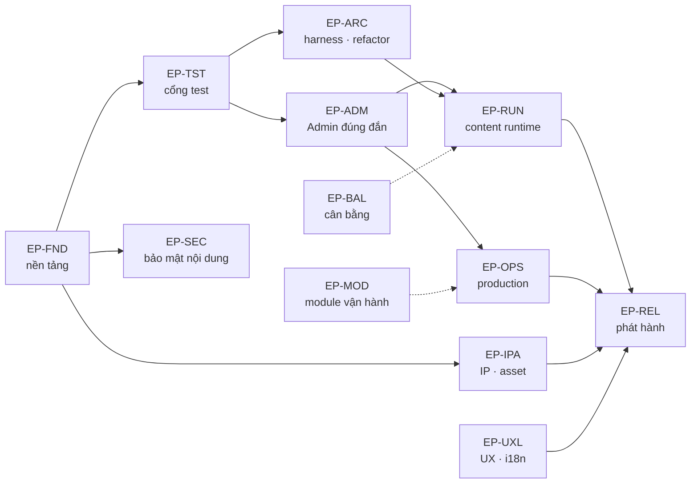

# ARCHITECTURE

Kiến trúc **hiện tại** (đã đối chiếu source, không phải phỏng đoán) và kiến trúc **đích** được đề xuất dưới dạng ADR. Các ADR đều ở trạng thái **Đề xuất** cho tới khi chủ dự án quyết định các `DEC-xx` tương ứng.

Xem thêm: [PROJECT_ANALYSIS](./PROJECT_ANALYSIS.md) · [GAP_ANALYSIS](./GAP_ANALYSIS.md) · [RISKS](./RISKS.md).

## 1. Kiến trúc hiện tại

### 1.1 Bức tranh tổng thể

- **Game không phụ thuộc backend.** Cấu hình và story được nạp một lần lúc khởi động qua `fetch` (không credentials, timeout 2,5 s); mọi lỗi → dùng giá trị cục bộ. Bản standalone chạy mà không cần máy chủ.
- **Hai kênh nội dung công khai** chỉ trả bản đã publish (không bao giờ lộ bản nháp/actor/audit). Kênh thứ ba (nội dung gameplay) chưa có client.
- **Admin API không bật CORS**; cùng origin được kỳ vọng qua reverse proxy (xem ADR-004).

### 1.2 Game (`src/`)

| Lớp | Thành phần chính | Ghi chú |
|---|---|---|
| Điều phối | `Game` (3.322 dòng, ~100 phương thức), `StateMachine` (MENU, STORY, PLAYING, PAUSE, GAMEOVER, VICTORY, PRACTICE) | `Game.updatePlaying` (dòng 1185–1702) là hàm mô phỏng lõi |
| Mô phỏng | `WaveSystem` (spawn/wave/boss), `CombatSystem` + `StatusEffects` (sự kiện đồng bộ có thứ tự), `EventSystem` (bất ngờ giữa wave), `PhraseTracker` (câu thần chú), `Upgrades` | Ghost ngoài kế hoạch đi qua `WaveSystem.queueSpawn()` |
| Nhập liệu | `InputHandler` (Pointer Events, chủ sở hữu pointer), `GestureEngine` (resample → chuẩn hoá → khớp mẫu có hướng + gate hình học) | Nhận diện khi nhả, không mỗi khung |
| Thực thể | `Enemy` (2.991 dòng, kể cả vẽ), `Player`, `Projectile`, `ObjectPool` | Enemy/Projectile được pool; `combatGeneration` chống dùng nhầm ghost đã tái sử dụng |
| Trình bày | `UIManager`, `MetaUI`, `StoryCanvasRenderer`, `WizardCardRenderer`, `BackgroundRenderer`, `ParticleSystem`, `DangerIndicator` | UI dựng bằng DOM + canvas; chuỗi cứng tiếng Việt |
| Âm thanh | `SoundSystem` (2.457 dòng; tổng hợp Web Audio + sheet mp3), `AudioSystem` (mặt tiền) | Sheet mp3 nạp qua `fetch` với danh sách đường dẫn ứng viên |
| Tiến trình | `ProgressStore`, `Settings`, `RunSave` (Endless), `Challenge` (seed theo ngày), `Lore`, `Companions`, `Cosmetics`, `Achievements` | Khoá `localStorage`: `arcane_paws_{high_score,unlocked_level,tutorial_completed,difficulty,settings,progress,endless_save}_v1` |
| Chất lượng | `QualityManager` (tier thích ứng), `HapticSystem`, `HighlightRecorder` | Glow minion dùng sprite cache, không `shadowBlur` |
| Story | `StoryScenes`, `StoryDirector` (đồng hồ thuần, không `setTimeout`), `shared/story/*` | Nội dung từ `shared/story/runtime.js` (seed hoặc bản publish) |

**Quy ước kiến trúc đang được test khoá** (tóm tắt; chi tiết ở [EXECUTION_RULES §6](./EXECUTION_RULES.md)): logic theo khung ngoài mô phỏng lõi đặt ở `PlayingState.update`/`Game.advanceEffects`; bất ngờ/gimmick boss đi qua `queueSpawn` và `Enemy.gimmickEvent` (Game phản ứng, Enemy chỉ phát tín hiệu); cấu hình/nội dung được **ghim bất biến theo ván** (`Game.resetGameData`, dòng 932).

### 1.3 Luồng dữ liệu

| Luồng | Đường đi | Cơ chế an toàn |
|---|---|---|
| Cấu hình | Admin save→validate→review→publish → `GET /api/game-config/:env` → `RemoteConfiguration.load` → `Game.runConfiguration` (deep-freeze) | Kiểm `schemaVersion`, `environment`, `validateConfig`; lỗi → `local` |
| Story | Admin draft→publish → `GET /api/story-content/published` → `loadPublishedStory` → `installStory` (validate đồ thị, cycle) | Lỗi → seed gói sẵn; phiên chơi ghim đồ thị |
| Gameplay content | Admin lifecycle → `GET /api/game-content/:env` → **(không có consumer)** | — (GAP-101) |
| Tiến trình người chơi | Game → `localStorage` (có `try/catch`, dữ liệu hỏng → bắt đầu mới) | Không gửi lên máy chủ |

### 1.4 Admin

**SPA** (`admin/src`): `main.tsx` (router, shell, theme), `auth/Auth.tsx` (khôi phục phiên, route guard theo quyền do server cấp), `ConfigurationPage`, `GameplayPage` (editor schema-driven + undo/redo 50 bước + preview `Enemy`), `StoryPage` (đồ thị SVG + preview bằng cùng `createSession/advance` của runtime), `pages.tsx` (Dashboard, khung các module).

**API** (`admin/server`) — Node `http` thuần, một tiến trình:

| Endpoint | Quyền | Ghi chú |
|---|---|---|
| `POST /api/auth/login`, `GET /api/auth/me`, `POST /api/auth/logout` | công khai / phiên | scrypt, cookie `ap_session` (`HttpOnly; SameSite=Strict; Path=/api`, 8 giờ), throttle 5/15 phút theo socket |
| `GET /api/dashboard`, `GET /api/system` | `dashboard:read`, `system:read` | số liệu telemetry là `null` |
| `GET/POST /api/configuration/environments/:env[/save\|validate\|review\|publish\|rollback]` | `configuration:*` | khoá lạc quan bằng `revision` → 409 |
| `GET /api/game-config/:env` | công khai | chỉ bản publish |
| `GET/POST /api/gameplay/environments/:env[/…]` | hiện dùng `configuration:*` (GAP-303) | cùng máy trạng thái vòng đời |
| `GET /api/game-content/:env` | công khai | chỉ bản publish |
| `GET /api/content/story`, `POST /api/content/story/{draft,publish}` | `content:*` | giới hạn body 2 MiB |
| `GET /api/story-content/published` | công khai | release mới nhất |
| `GET /api/{gameplay,content,liveops,players,analytics}` | `<module>:read` | khung `not_connected` |
| `POST /api/configuration` | `configuration:write` | endpoint legacy |

**RBAC** (`policy.mjs`): Super Admin (mọi module + `configuration:review/publish`); Game Designer (dashboard, configuration, gameplay); Content Editor (dashboard, content, liveops); Analyst (dashboard, analytics, gameplay:read); Support (dashboard, players).

**Kiểm soát bảo mật hiện có:** mọi mutation cần header `X-Admin-Request: 1` và Origin cùng host; cookie `HttpOnly/SameSite=Strict`; so sánh mật khẩu `timingSafeEqual` trên băm scrypt; không bật CORS; `Cache-Control: no-store`; kiểm kích thước body; validate nghiêm ngặt (schema strict, từ chối trường lạ).

**Lưu trữ:** `store.json` chứa `configuration[]`, `audit[]`, `environments{}`, `contentEnvironments{}`, `story{}`. Mọi thay đổi đi qua `mutate()` tuần tự: `structuredClone` → áp dụng → ghi `store.tmp` → `rename`. Phù hợp **một tiến trình, một host** (README thừa nhận).

### 1.5 `shared/` và ranh giới ghép nối

`shared/` là mã đẳng cấu dùng cho game, API và SPA: `game-configuration.js` (schema v1, `validateConfig`, `freezeConfig`), `gameplay-content.js` (schema, `validateContent`, `contentTimeline`), `story/engine.js` (validate đồ thị, `createSession/advance`), `story/runtime.js` (cài đặt story đang hoạt động). **Ghép nối cần theo dõi:** `gameplay-content.js` import `src/core/Constants.js`; `GameplayPage.tsx` import `src/entities/Enemy.js` (kéo cả renderer 2.991 dòng vào bundle admin); `gameplay-content.types.ts` viết tay song song với schema (GAP-112).

## 2. Điểm yếu kiến trúc

1. **`Game` là lớp "god"**: điều phối + mô phỏng + story + meta + cosmetics + lưu Endless trong một file 3.322 dòng; `updatePlaying` ~517 dòng; hai test phải dựng fake-context → rào cản cho mọi thay đổi lõi (GAP-113).
2. **Hai mô hình wave không tương thích**: `WaveSystem` (theo số lượng) và `contentSchema` (theo thời gian tuyệt đối), cộng schema thứ ba trong GDD §5 (GAP-101/102).
3. **Boss gimmick cứng theo loại** (`BOSS_GIMMICKS`), không cấu hình theo dữ liệu.
4. **Lưu trữ Admin một tiến trình**; endpoint công khai của game dùng chung tiến trình với admin và bị `no-store` (GAP-110).
5. **Asset và thương hiệu chưa rõ nguồn gốc/giấy phép**; loader asset có danh sách đường dẫn ứng viên chồng chéo (GAP-310/311/401).
6. **Cổng chất lượng yếu**: không CI, test mock DOM, orphan/flaky/xanh giả (GAP-307/308/309/201).
7. **Không có lớp chịu lỗi runtime**: `Game.loop` đặt lại `requestAnimationFrame` sau `update()`/`render()` mà không có `try/catch` nên một ngoại lệ dừng game vĩnh viễn; không có handler lỗi toàn cục; Admin SPA không có ErrorBoundary (GAP-312, GAP-204).

## 3. Nguyên tắc ràng buộc (guardrails)

Những bất biến mà MỌI thay đổi phải giữ — vi phạm là lý do từ chối PR:

1. **Lỗi nạp từ xa không bao giờ làm hỏng game** (config/story/content → fallback cục bộ, không ném).
2. **Ghim bất biến theo ván**: cấu hình/nội dung áp dụng lúc bắt đầu ván và được deep-freeze; bản publish mới không ảnh hưởng ván đang chạy.
3. **Endpoint công khai chỉ trả bản đã publish**; không bao giờ lộ bản nháp, actor, audit.
4. **Mọi mutation Admin**: cần phiên hợp lệ + `X-Admin-Request` + cùng origin + kiểm tra quyền **phía server** + kiểm tra `revision` (409). Không nhận `role` do client chọn.
5. **Văn bản do CMS cung cấp luôn được hiển thị bằng `textContent`** (hoặc qua `escapeStoryText`), không bao giờ nội suy vào `innerHTML`.
6. **Mã trong `shared/` phải đẳng cấu** (không DOM, không API riêng của Node) trừ import dữ liệu hằng số đã được ghi nhận.
7. **Mô phỏng tất định ở nơi cần tái lập** (thử thách ngày dùng RNG theo seed/wave); không thêm `Math.random()` vào logic lựa chọn spawn cần tái lập.
8. **Test không được xanh giả**: mọi suite phải thoát ≠ 0 khi có assertion hỏng; mọi file test phải nằm trong manifest (TST-03).
9. **Một ngoại lệ ở một khung hình không được làm dừng vòng lặp game**, và lỗi render của một trang Admin không được làm trắng cả SPA: bắt theo khung, đặt lại `requestAnimationFrame` trong `finally`, khôi phục trạng thái canvas, ghi log (ARC-06, ADM-07).

## 4. Kiến trúc đích — ADR đề xuất

### ADR-001 — Một cổng test trung thực
- **Trạng thái:** Đề xuất (không cần quyết định bên ngoài). **Task:** TST-01, TST-02, TST-03, FND-05.
- **Bối cảnh:** chuỗi `&&` 800 ký tự; flaky ~1/3 số lần; test mềm; 6 suite ngoài cổng; admin ngoài cổng.
- **Quyết định:** runner `scripts/run-tests.mjs` + `tests/manifest.json` (suites/quarantine), orphan guard, phát hiện lỗi mềm bằng bộ đếm "Failed"; CI chạy runner.
- **Hệ quả:** lỗi từng bị che sẽ lộ ra; quarantine phải có `reason` và `task` và về 0 ở Sprint 1.

### ADR-002 — Nội dung gameplay phát lại bằng `ScriptedWaveSource` trong chế độ riêng
- **Trạng thái:** Đề xuất, chờ **DEC-02**. **Task:** RUN-01..RUN-09.
- **Bối cảnh:** content là lịch theo thời gian; WaveSystem theo số lượng; Story/Endless có test khoá và không được đổi hành vi.
- **Quyết định đề xuất:** chế độ mới "Chiến dịch tùy chỉnh", bật bằng `VITE_GAME_CONTENT_URL`; adapter thuần chuyển định nghĩa → spawn config; script đi qua `WaveSystem.queueSpawn`; ghim snapshot theo ván; fallback = không có chế độ.
- **Phương án khác:** (B) ánh xạ thành tham số WaveSystem — đơn giản hơn nhưng mất timeline; (C) hoãn.
- **Hệ quả:** Story/Endless không đổi; cần mở rộng nhỏ `Enemy.init` (`scoreValue`, `contactDamage`, `gimmick`) và khối spawn của `Game.updatePlaying` (hỗ trợ `spawnSide`).

### ADR-003 — Giao diện repository và adapter SQLite cho Admin
- **Trạng thái:** Đề xuất, chờ **DEC-05**. **Task:** OPS-01, OPS-02, OPS-03, ADM-05.
- **Quyết định đề xuất:** `repository.mjs` (read/transact/appendAudit) với adapter JSON (giữ nguyên hành vi) và adapter SQLite (`BEGIN IMMEDIATE`); session/throttle lưu bền (băm token); bộ test hợp đồng chạy trên cả hai adapter.
- **Hệ quả:** thêm một dependency (SQLite) cần duyệt; Postgres là lối đi tiếp nếu cần đa-instance (DEC-05 = C).

### ADR-004 — Triển khai tham chiếu và xuất bản tĩnh
- **Trạng thái:** Đề xuất, chờ **DEC-05**. **Task:** OPS-04, OPS-05, ADM-04.
- **Quyết định đề xuất:** Docker + nginx mẫu (cùng origin HTTPS, allowlist công khai cho 3 endpoint GET, cache ngắn), `/api/health`, CSP; tuỳ chọn `ADMIN_PUBLISH_DIR` ghi JSON bất biến cho CDN để game không phụ thuộc tiến trình admin.
- **Hệ quả:** endpoint công khai có thể được cache; `ADMIN_TRUST_PROXY=1` bắt buộc sau proxy.

### ADR-005 — Chính sách asset và `ASSET_MANIFEST`
- **Trạng thái:** Đề xuất, chờ **DEC-03/DEC-09**. **Task:** IPA-01..IPA-07.
- **Quyết định đề xuất:** kiểm kê (ASSETS.md); một thư mục asset chuẩn; asset thuộc danh sách "replace/remove" bị tắt qua `ASSET_MANIFEST`, game rơi về âm thanh tổng hợp và nhân vật vector; không có URL tới host bên thứ ba trong runtime (test chặn).
- **Hệ quả:** chất lượng thẩm mỹ của nhánh vector là đánh đổi sản phẩm cần chủ dự án chấp nhận.

### ADR-006 — i18n theo khoá, áp dụng bằng `textContent`
- **Trạng thái:** Đề xuất, chờ **DEC-07**. **Task:** UXL-01, UXL-02.
- **Quyết định đề xuất:** `src/i18n` (`t`, `setLocale`, fallback `vi`), khoá `language` trong `Settings`, `data-i18n` cập nhật bằng `textContent`; đồng bộ với `setStoryLocale`.

### ADR-007 — Chính sách artifact build
- **Trạng thái:** Đề xuất, chờ **DEC-08**. **Task:** FND-01, FND-04.
- **Quyết định đề xuất:** chỉ track `arcane-paws-standalone.html`; ignore `dist/`; `verify:artifacts` chạy trong CI so sánh với build tạm (build tất định đã được xác minh).

## 5. Sơ đồ phụ thuộc cấp epic

