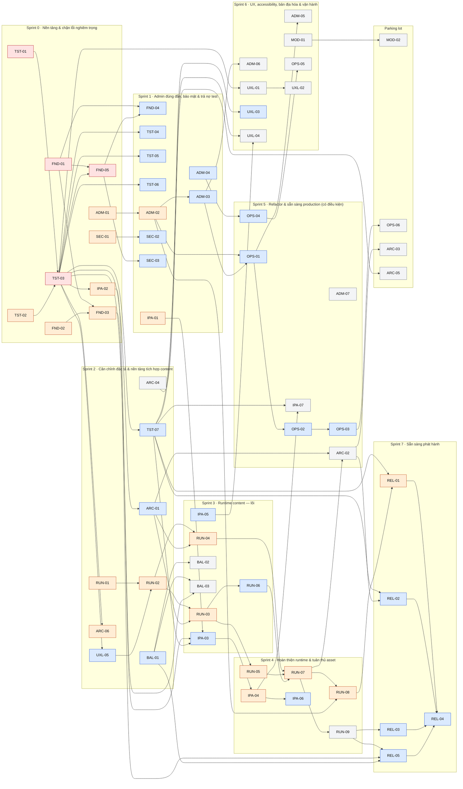

# SPRINT PLAN

> **File sinh tự động từ [`tasks.json`](./tasks.json) bởi `tools/plan.mjs render`. KHÔNG sửa tay.**

## Giả định về năng lực

- Sức chứa giả định: **20 SP/sprint** (±4). GIẢ ĐỊNH CHƯA XÁC MINH: ~20 SP/sprint (±4), căn theo nhịp lịch sử 26 PR gộp / 11 ngày. Hiệu chỉnh lại sau Sprint 0 bằng số SP thực tế hoàn thành.
- Kế hoạch được lập với MỌI quyết định ở phương án khuyến nghị. Nếu chủ dự án chọn phương án khác, cần lập lại kế hoạch (ví dụ DEC-02 = C hủy phần lớn nhóm RUN; DEC-05 = A hủy OPS-01..05 và ADM-05; DEC-07 = A hủy UXL-01/02).
- Task chỉ được bắt đầu khi mọi dependency `done` VÀ mọi quyết định chặn đã `decided`.

## Tổng quan sprint

| Sprint | Tên | Trạng thái | Task | SP | So với sức chứa giả định | Quyết định cần có trước |
|---:|---|---|---:|---:|---:|---|
| [S0](#sprint-0) | Nền tảng & chặn lỗi nghiêm trọng | in_progress | 10 | 19 | 95% | — |
| [S1](#sprint-1) | Admin đúng đắn, bảo mật & trả nợ test | not_started | 10 | 21 | 105% | DEC-08, DEC-10 |
| [S2](#sprint-2) | Căn chỉnh đặc tả & nền tảng tích hợp content | not_started | 8 | 22 | 110% | DEC-01, DEC-02 |
| [S3](#sprint-3) | Runtime content — lõi | not_started | 7 | 21 | 105% | DEC-03, DEC-04 |
| [S4](#sprint-4) | Hoàn thiện runtime & tuân thủ asset | not_started | 6 | 22 | 110% | — |
| [S5](#sprint-5) | Refactor & sẵn sàng production (có điều kiện) | not_started | 7 | 24 | 120% | DEC-05, DEC-09 |
| [S6](#sprint-6) | UX, accessibility, bản địa hóa & vận hành | not_started | 8 | 24 | 120% | DEC-06, DEC-07 |
| [S7](#sprint-7) | Sẵn sàng phát hành | not_started | 5 | 15 | 75% | — |
| [Parking](#parking-lot) | Có điều kiện / tùy chọn | — | 4 | 21 | — | — |
| **Tổng** | | | **65** | **189** | | |

Tổng SP = **189**: đã xếp sprint **168** (61 task) + parking lot **21** (4 task). "Trạng thái" của sprint được SUY RA từ trạng thái các task (không lưu riêng nên không thể lỗi thời).

## Đồ thị dependency

Màu: đỏ = P0, cam = P1, xanh = P2, xám = P3. Mũi tên A → B nghĩa là B phụ thuộc A.

## Sprint 0

### Nền tảng & chặn lỗi nghiêm trọng

**Sprint Goal.** Có baseline đáng tin: repo sạch và tái lập được, cổng test xanh thật sự (hết flaky/xanh giả), CI tự động, và ba lỗi chặn nghiêm trọng (XSS, hỏng UTF-8, hotlink Google) được vá.

**Scope.** Vệ sinh repo (FND-01..03), cổng test (TST-01..03), CI (FND-05), quick-win chặn lỗi (ADM-01, SEC-01, IPA-02).

**Trạng thái.** in_progress

**Quy mô.** 10 task · **19 SP** (95% sức chứa giả định 20 SP)

**Quyết định cần có trước khi bắt đầu sprint.** không

**Task (theo thứ tự thực hiện gợi ý).**

| Task | Tiêu đề | P | SP | Dependencies | Quyết định chặn | Executor |
|---|---|---|---:|---|---|---|
| ADM-01 | Sửa giải mã UTF-8 khi đọc body request (gom Buffer, decode một lần) | P1 | 2 | — | — | agent |
| FND-01 | Gỡ node_modules khỏi git và thêm .gitignore gốc | P0 | 2 | — | — | agent+human |
| FND-02 | Ghim runtime: .nvmrc, engines và ghi chú package manager | P1 | 1 | — | — | agent |
| FND-03 | Viết README gốc (cài đặt, chạy, test, build, biến môi trường) | P1 | 2 | FND-01, FND-02 | — | agent |
| SEC-01 | Vá sink XSS: không đưa văn bản CMS vào innerHTML | P1 | 2 | — | — | agent |
| TST-01 | Làm test "blood moon" tất định (hết flaky) | P0 | 1 | — | — | agent |
| TST-02 | Sửa test "xanh giả": test-performance-system.js không bao giờ thoát ≠ 0 | P1 | 1 | — | — | agent |
| TST-03 | Runner test thống nhất, manifest và "orphan guard" | P0 | 3 | TST-01, TST-02 | — | agent |
| FND-05 | Thêm GitHub Actions CI cho game và admin | P0 | 3 | FND-01, TST-03 | — | agent |
| IPA-02 | Gỡ URL dự phòng tải tài nguyên trực tiếp từ google.com | P1 | 2 | TST-03 | — | agent |

**Dependencies từ sprint trước.** không

**Deliverables.**

- `.gitignore` gốc; `node_modules/` không còn bị track
- README gốc, `.nvmrc`, `engines`
- `scripts/run-tests.mjs` + `tests/manifest.json` có "orphan guard" và quarantine
- Test blood-moon tất định; `test-performance-system.js` trả exit code đúng
- `.github/workflows/ci.yml`
- Vá XSS (UIManager), vá UTF-8 (app.mjs), gỡ hotlink google.com — mỗi cái có test hồi quy

**Acceptance Criteria.**

- `npm test` xanh 20 lần liên tiếp
- Một PR thử trên CI chạy xanh cả job game lẫn admin
- Không còn đường dẫn nào trong `git ls-files` bắt đầu bằng `node_modules/`
- Test hồi quy của ADM-01/SEC-01 FAIL khi hoàn tác bản vá và PASS khi có bản vá

**Exit Criteria.**

- Mọi task Sprint 0 ở trạng thái `done` kèm evidence
- Số liệu baseline (số test, thời gian, exit code) được ghi lại trong PROGRESS.md
- Chủ dự án đã duyệt thao tác gỡ index (FND-01)

**Rủi ro.**

- Gỡ `node_modules` khỏi index cần người duyệt và buộc mọi dev chạy lại `pnpm install`
- Khi exit code trở nên trung thực, có thể lộ ra thất bại bị che giấu trước đó
- CI trên Linux có thể lộ giả định chỉ đúng trên macOS (đường dẫn, binary native)

## Sprint 1

### Admin đúng đắn, bảo mật & trả nợ test

**Sprint Goal.** Admin API lưu được nội dung gameplay lớn, phân quyền nhất quán, throttle đúng sau proxy, nội dung CMS an toàn nhiều lớp; ba suite mồ côi hỏng được sửa; chính sách artifact và kiểm kê IP hoàn tất.

**Scope.** ADM-02..04, SEC-02..03, TST-04..06, FND-04, IPA-01.

**Trạng thái.** not_started

**Quy mô.** 10 task · **21 SP** (105% sức chứa giả định 20 SP)

**Quyết định cần có trước khi bắt đầu sprint.** DEC-08 (Chính sách artifact build và package manager); DEC-10 (Mô hình quyền cho Gameplay content)

**Task (theo thứ tự thực hiện gợi ý).**

| Task | Tiêu đề | P | SP | Dependencies | Quyết định chặn | Executor |
|---|---|---|---:|---|---|---|
| ADM-02 | Giới hạn body theo route và test HTTP end-to-end cho vòng đời Gameplay | P1 | 2 | ADM-01 | — | agent |
| ADM-03 | Đồng bộ mô hình quyền Gameplay (gameplay:* thay configuration:*) | P2 | 3 | ADM-02 | DEC-10 | agent |
| ADM-04 | Throttle đăng nhập đúng sau reverse proxy và giới hạn bộ nhớ | P2 | 2 | — | — | agent |
| FND-04 | Áp dụng chính sách artifact build và script kiểm tra độ mới | P2 | 2 | FND-01, FND-05 | DEC-08 | agent+human |
| IPA-01 | Kiểm kê asset và dấu vết IP (docs/ASSETS.md) | P1 | 2 | — | — | agent+human |
| SEC-02 | Validator story từ chối markup và chuỗi quá dài | P2 | 2 | SEC-01 | — | agent |
| SEC-03 | Audit phụ thuộc và cấu hình Dependabot | P2 | 2 | FND-05 | — | agent |
| TST-04 | Sửa suite lỗi thời: scripts/test-center-cat-boss-tutorial.js | P2 | 2 | TST-03 | — | agent |
| TST-05 | Sửa suite lỗi thời: scripts/test-boss-minions-and-scary-face.js | P2 | 2 | TST-03 | — | agent |
| TST-06 | Sửa suite lỗi thời: scripts/test-monster-sounds.js (dùng cast identity thật) | P2 | 2 | TST-03 | — | agent |

**Dependencies từ sprint trước.** ADM-01, FND-01, FND-05, SEC-01, TST-03

**Deliverables.**

- Giới hạn body theo route + test HTTP end-to-end cho vòng đời gameplay
- Ma trận quyền (role × endpoint) được test tự động
- Throttle hỗ trợ `ADMIN_TRUST_PROXY`
- Validator story từ chối markup + giới hạn độ dài
- Dependabot + bước audit trong CI
- 3 suite cũ sửa xong và trở lại cổng test
- `docs/ASSETS.md` kiểm kê asset/IP
- Script `verify:artifacts` + chính sách artifact áp dụng

**Acceptance Criteria.**

- Tài liệu gameplay ≥ 100 KB lưu được (HTTP 200); > giới hạn mới trả 413
- Analyst: GET gameplay = 200, POST = 403 (theo DEC-10)
- Không còn suite nào trong danh sách quarantine
- `npm run verify:artifacts` thoát 0 khi artifact mới, thoát khác 0 khi cũ

**Exit Criteria.**

- Mọi task Sprint 1 `done` kèm evidence
- DEC-08 và DEC-10 đã được chủ dự án quyết định trước khi bắt đầu các task bị chặn

**Rủi ro.**

- Đổi namespace quyền (ADM-03) có thể khiến người dùng hiện tại mất quyền nếu cấu hình khác giả định
- Sửa test cũ có thể phát hiện lỗi production thật → phát sinh task BUG mới

## Sprint 2

### Căn chỉnh đặc tả & nền tảng tích hợp content

**Sprint Goal.** Chốt đặc tả (cân bằng, ánh xạ content→runtime), có bộ nạp content có fallback, harness đặc trưng cho Game và smoke test trình duyệt làm nền cho tích hợp và refactor; vòng lặp game được bảo vệ khỏi ngoại lệ trước khi dữ liệu content chảy vào đường update/render.

**Scope.** RUN-01, RUN-02, BAL-01, ARC-01, ARC-04, ARC-06, UXL-05, TST-07.

**Trạng thái.** not_started

**Quy mô.** 8 task · **22 SP** (110% sức chứa giả định 20 SP)

**Quyết định cần có trước khi bắt đầu sprint.** DEC-01 (Nguồn sự thật cho số liệu cân bằng (GDD vs code)); DEC-02 (Mô hình runtime cho Gameplay Content đã publish)

**Task (theo thứ tự thực hiện gợi ý).**

| Task | Tiêu đề | P | SP | Dependencies | Quyết định chặn | Executor |
|---|---|---|---:|---|---|---|
| ARC-01 | Harness đặc trưng cho Game: createTestGame() và golden-master cho vòng lặp | P2 | 3 | TST-03 | — | agent |
| ARC-04 | Sinh gameplay-content.types.ts từ schema và test chống lệch | P3 | 2 | — | — | agent |
| ARC-06 | Vòng lặp game chịu lỗi: bắt ngoại lệ theo khung, handler lỗi toàn cục và màn hình khôi phục | P1 | 3 | TST-03 | — | agent |
| BAL-01 | docs/BALANCE.md sinh từ code và đối chiếu GDD | P2 | 3 | — | DEC-01 | agent |
| RUN-01 | Đặc tả ánh xạ Gameplay Content → runtime và ADR chọn mô hình tích hợp | P1 | 3 | — | DEC-02 | agent+human |
| TST-07 | Smoke test trên trình duyệt thật (Chrome headless qua CDP) | P2 | 3 | TST-03 | — | agent |
| UXL-05 | Khởi động song song cấu hình + story và màn chờ | P2 | 2 | TST-03 | — | agent |
| RUN-02 | Bộ nạp RemoteGameplayContent: nạp, kiểm tra, đóng băng, fallback | P1 | 3 | RUN-01, UXL-05 | DEC-02 | agent |

**Dependencies từ sprint trước.** TST-03

**Deliverables.**

- `docs/BALANCE.md` + GDD trỏ về
- `docs/gameplay-content-runtime.md` (ADR + bảng ánh xạ trường)
- `RemoteGameplayContent` + biến `VITE_GAME_CONTENT_URL`
- `tests/helpers/create-game.js` và 5 kịch bản golden-master; 2 test dùng fake-context được chuyển sang harness
- Types TS sinh từ schema + test chống lệch
- Boot nạp song song cấu hình + story
- `scripts/e2e-smoke.mjs` chạy trên Chrome headless
- Vòng lặp game chịu lỗi: bắt ngoại lệ theo khung, handler lỗi toàn cục, màn hình khôi phục + test hồi quy `test-loop-resilience.js`

**Acceptance Criteria.**

- Loader trả `published = null` (không ném lỗi) với 404, timeout, schema sai, env sai, giá trị không hợp lệ
- Smoke test thoát 0 và thoát khác 0 khi trang ném lỗi
- Thời gian boot tối đa ≈ một timeout (2.5s) thay vì hai
- Ngoại lệ ở `update()`/`render()` không dừng vòng lặp; sau 3 khung lỗi liên tiếp hiện màn hình khôi phục

**Exit Criteria.**

- DEC-01 và DEC-02 đã quyết định; ADR RUN-01 được chủ dự án duyệt
- Mọi task Sprint 2 `done` kèm evidence

**Rủi ro.**

- DEC-02 chọn C sẽ hủy phần lớn nhóm RUN
- Harness golden-master có thể làm lộ hành vi hiện tại là ngẫu nhiên/không tất định
- Màn hình khôi phục có thể che giấu lỗi thật — chỉ hiện sau ≥ 3 khung lỗi liên tiếp và luôn ghi log

## Sprint 3

### Runtime content — lõi

**Sprint Goal.** Game phát lại enemy và lịch wave từ content đã publish (adapter enemy + ScriptedWaveSource + elite/status) dưới biến môi trường; asset được dedupe, thương hiệu thống nhất, cân bằng được đo.

**Scope.** RUN-03, RUN-04, RUN-06, BAL-02, BAL-03, IPA-03, IPA-05.

**Trạng thái.** not_started

**Quy mô.** 7 task · **21 SP** (105% sức chứa giả định 20 SP)

**Quyết định cần có trước khi bắt đầu sprint.** DEC-03 (Chính sách với tài sản có nguồn gốc Google Doodle (audio + sprite) và rủi ro bản quyền); DEC-04 (Tên sản phẩm chính thức)

**Task (theo thứ tự thực hiện gợi ý).**

| Task | Tiêu đề | P | SP | Dependencies | Quyết định chặn | Executor |
|---|---|---|---:|---|---|---|
| BAL-02 | Áp dụng quyết định DDA (triển khai hoặc loại bỏ luật combo ≥ 15) | P3 | 2 | BAL-01 | DEC-01 | agent |
| BAL-03 | Harness mô phỏng cân bằng tất định và snapshot test | P3 | 3 | BAL-01, TST-03 | — | agent |
| IPA-03 | Chuẩn hoá thư mục asset, gỡ bản trùng và sửa đường dẫn 404 | P2 | 3 | IPA-01, IPA-02, TST-07 | — | agent |
| IPA-05 | Thống nhất tên sản phẩm trong UI, metadata và tài liệu | P2 | 2 | — | DEC-04 | agent |
| RUN-03 | Adapter enemy: content enemy → cấu hình spawn của game | P1 | 3 | RUN-02, ARC-01 | DEC-02 | agent |
| RUN-04 | ScriptedWaveSource: phát lại timeline content qua WaveSystem | P1 | 5 | RUN-02, ARC-01 | DEC-02 | agent |
| RUN-06 | Ánh xạ trạng thái (slow/stun) và elite modifier cho enemy từ content | P2 | 3 | RUN-03 | DEC-02 | agent |

**Dependencies từ sprint trước.** BAL-01, TST-03, IPA-01, IPA-02, TST-07, RUN-02, ARC-01

**Deliverables.**

- Adapter enemy (health→hàng đợi rune, speed→multiplier, score…)
- ScriptedWaveSource tích hợp WaveSystem qua đường `queueSpawn`
- Ánh xạ elite/status
- Quyết định DDA được áp dụng
- Harness mô phỏng cân bằng + snapshot test
- Thư mục asset chuẩn, không 404
- Tên sản phẩm thống nhất

**Acceptance Criteria.**

- Timeline mẫu spawn đúng thời điểm ±1 frame trong mô phỏng tất định
- Story/Endless không đổi hành vi (golden-master ARC-01 vẫn xanh)
- Smoke test: không còn 404 asset (trừ favicon cho đến UXL-04)

**Exit Criteria.**

- DEC-03 và DEC-04 đã quyết định
- Mọi task Sprint 3 `done` kèm evidence

**Rủi ro.**

- RUN-04 chạm khối spawn trong `Game.updatePlaying` (~dòng 1252–1377)
- Dedupe asset có thể làm hỏng đường dẫn khi triển khai ở sub-path

## Sprint 4

### Hoàn thiện runtime & tuân thủ asset

**Sprint Goal.** Boss/khả năng chạy bằng content, chế độ chơi đầy đủ với pin snapshot và fallback, test tích hợp end-to-end; asset có vấn đề bản quyền được thay thế; có LICENSE và NOTICES.

**Scope.** RUN-05, RUN-07, RUN-08, RUN-09, IPA-04, IPA-06.

**Trạng thái.** not_started

**Quy mô.** 6 task · **22 SP** (110% sức chứa giả định 20 SP)

**Quyết định cần có trước khi bắt đầu sprint.** không

**Task (theo thứ tự thực hiện gợi ý).**

| Task | Tiêu đề | P | SP | Dependencies | Quyết định chặn | Executor |
|---|---|---|---:|---|---|---|
| IPA-04 | Thay thế hoặc gỡ asset có nguồn gốc Google Doodle theo DEC-03 | P1 | 8 | IPA-03 | DEC-03 | agent+human |
| IPA-06 | Thêm LICENSE và THIRD_PARTY_NOTICES.md | P2 | 1 | IPA-04 | DEC-03 | agent+human |
| RUN-05 | Adapter boss: pha, ngưỡng HP và khả năng (gimmick) theo dữ liệu | P1 | 5 | RUN-03 | DEC-02 | agent |
| RUN-07 | Chế độ "Chiến dịch tùy chỉnh": pin snapshot, fallback, phạm vi lưu | P1 | 3 | RUN-04, RUN-05, RUN-06 | DEC-02 | agent |
| RUN-08 | Test tích hợp publish → nạp → mô phỏng (và các kịch bản fallback) | P1 | 3 | RUN-07, ADM-02 | — | agent |
| RUN-09 | Chỉ báo "runtime hỗ trợ" trong editor và cập nhật tài liệu | P3 | 2 | RUN-07 | — | agent |

**Dependencies từ sprint trước.** IPA-03, RUN-03, RUN-04, RUN-06, ADM-02

**Deliverables.**

- Adapter boss (pha, gimmick theo dữ liệu)
- Chế độ "Chiến dịch tùy chỉnh" + pin snapshot + fallback
- Test tích hợp publish→load→simulate
- Chỉ báo "runtime hỗ trợ" trong editor + docs cập nhật
- Asset pack đã thay thế theo DEC-03
- LICENSE + THIRD_PARTY_NOTICES.md

**Acceptance Criteria.**

- Boss do content định nghĩa đổi pha đúng ngưỡng HP
- Khi server content tắt/hỏng, game chạy y hệt không có content
- Kiểm kê asset: không còn mục "không rõ giấy phép" ở trạng thái keep

**Exit Criteria.**

- Mọi task Sprint 4 `done` kèm evidence
- IPA-04 được chủ dự án xác nhận (asset là nội dung sáng tạo, cần người duyệt)

**Rủi ro.**

- IPA-04 phụ thuộc nguồn lực art/audio bên ngoài — có thể trễ
- Gimmick theo dữ liệu có thể đòi hỏi refactor Enemy lớn hơn dự kiến

## Sprint 5

### Refactor & sẵn sàng production (có điều kiện)

**Sprint Goal.** Tách `updatePlaying` an toàn; Admin lưu trữ bền vững (repository + SQL + session) có hướng dẫn triển khai; standalone đúng hợp đồng.

**Scope.** ARC-02, ADM-07, OPS-01..04, IPA-07.

**Trạng thái.** not_started

**Quy mô.** 7 task · **24 SP** (120% sức chứa giả định 20 SP)

**Quyết định cần có trước khi bắt đầu sprint.** DEC-05 (Phạm vi triển khai của Admin (quyết định có làm nhóm OPS hay không)); DEC-09 (Hợp đồng của bản standalone (file:// một file))

**Task (theo thứ tự thực hiện gợi ý).**

| Task | Tiêu đề | P | SP | Dependencies | Quyết định chặn | Executor |
|---|---|---|---:|---|---|---|
| ADM-07 | ErrorBoundary cho Admin SPA: lỗi render không làm trắng cả trang | P3 | 2 | — | — | agent |
| ARC-02 | Tách Game.updatePlaying thành các bước nhỏ (không đổi hành vi) | P3 | 5 | ARC-01, RUN-07 | — | agent |
| IPA-07 | Bản standalone tự đủ theo hợp đồng DEC-09 | P3 | 3 | IPA-04, TST-07 | DEC-09 | agent |
| OPS-01 | Giao diện repository lưu trữ (adapter JSON) tách khỏi app.mjs | P2 | 3 | ADM-02, ADM-03 | DEC-05 | agent |
| OPS-02 | Adapter SQLite và script migrate từ store.json | P2 | 5 | OPS-01 | DEC-05 | agent+human |
| OPS-03 | Session và throttle bền vững (không mất khi restart) | P2 | 3 | OPS-02 | DEC-05 | agent |
| OPS-04 | Cấu hình triển khai tham chiếu: Docker, proxy, CSP, health | P2 | 3 | ADM-04 | DEC-05 | agent+human |

**Dependencies từ sprint trước.** ARC-01, RUN-07, IPA-04, TST-07, ADM-02, ADM-03, ADM-04

**Deliverables.**

- `updatePlaying` chia thành các bước nhỏ, hành vi không đổi
- Giao diện repository + adapter JSON + adapter SQLite + script migrate
- Session/throttle bền vững
- Dockerfile, cấu hình proxy mẫu, CSP, `/api/health`
- Standalone theo DEC-09
- ErrorBoundary quanh vùng nội dung của Admin SPA + test

**Acceptance Criteria.**

- Golden-master và toàn bộ test game xanh sau refactor
- Bộ test hợp đồng repository chạy xanh trên cả hai adapter
- Restart server không làm mất phiên đăng nhập
- Lỗi render ở một trang Admin không làm mất menu/topbar

**Exit Criteria.**

- DEC-05 và DEC-09 đã quyết định; nếu DEC-05 = A thì OPS-01..04 + ADM-05 chuyển `cancelled`
- Mọi task còn lại `done` kèm evidence

**Rủi ro.**

- Refactor lõi vòng lặp là rủi ro hồi quy cao nhất của kế hoạch
- SQLite native module/Node built-in còn thử nghiệm có thể gây khó khăn CI

## Sprint 6

### UX, accessibility, bản địa hóa & vận hành

**Sprint Goal.** Đổi ngôn ngữ lúc chạy, accessibility, favicon/manifest; xuất bản tĩnh cho CDN; retention dữ liệu; làm sạch Admin; chốt spec module vận hành.

**Scope.** UXL-01..04, OPS-05, ADM-05, ADM-06, MOD-01.

**Trạng thái.** not_started

**Quy mô.** 8 task · **24 SP** (120% sức chứa giả định 20 SP)

**Quyết định cần có trước khi bắt đầu sprint.** DEC-06 (Lộ trình các module Live Operations / Players / Analytics); DEC-07 (Ngôn ngữ giao diện game)

**Task (theo thứ tự thực hiện gợi ý).**

| Task | Tiêu đề | P | SP | Dependencies | Quyết định chặn | Executor |
|---|---|---|---:|---|---|---|
| ADM-05 | Retention/compaction cho audit, versions và API danh sách release gọn | P3 | 3 | OPS-01 | DEC-05 | agent |
| ADM-06 | Dọn mã chết và chữ lỗi thời trong Admin | P3 | 2 | ADM-03 | — | agent |
| MOD-01 | Đặc tả yêu cầu cho Live Operations / Players / Analytics | P3 | 2 | — | DEC-06 | agent+human |
| OPS-05 | Xuất bản tĩnh: ghi JSON bất biến cho CDN khi publish | P3 | 2 | OPS-04 | DEC-05 | agent |
| UXL-01 | Hạ tầng i18n cho giao diện game (vi/en) và công tắc ngôn ngữ | P3 | 5 | TST-03 | DEC-07 | agent |
| UXL-02 | Trích xuất chuỗi chrome UI sang bảng i18n (≥ 90%) | P3 | 5 | UXL-01 | DEC-07 | agent+human |
| UXL-03 | Accessibility: ngữ nghĩa hộp thoại, quản lý focus, phóng to, nhãn | P2 | 3 | TST-07 | — | agent |
| UXL-04 | Favicon và web manifest | P3 | 2 | IPA-05, TST-07 | — | agent |

**Dependencies từ sprint trước.** OPS-01, ADM-03, OPS-04, TST-03, TST-07, IPA-05

**Deliverables.**

- `src/i18n` + Cài Đặt › Ngôn ngữ; ≥ 90% chuỗi chrome UI đã trích xuất
- Hộp thoại có role/aria/focus trap/Esc; cho phép phóng to
- Favicon + web manifest
- Xuất bản tĩnh `published/*.json`
- Retention/compaction + API danh sách tóm tắt
- Admin sạch mã chết; `docs/admin-modules-requirements.md`

**Acceptance Criteria.**

- Đổi ngôn ngữ cập nhật menu/HUD/Cài đặt không cần tải lại
- Smoke test xác nhận hộp thoại có `role="dialog"` và focus quay lại nút mở
- GET danh sách release không trả toàn bộ story

**Exit Criteria.**

- DEC-06 và DEC-07 đã quyết định; nếu DEC-07 = A thì UXL-01/02 `cancelled`
- Mọi task còn lại `done` kèm evidence

**Rủi ro.**

- Trích xuất chuỗi chạm nhiều file UI — dễ vỡ test khóa văn bản story
- Sprint nặng nhất (~24 SP) — có thể tách UXL-02 sang sprint kế tiếp

## Sprint 7

### Sẵn sàng phát hành

**Sprint Goal.** E2E mở rộng, harness hiệu năng, ngân sách kích thước bundle, checklist và changelog, hợp nhất tài liệu; quyết định go/no-go.

**Scope.** REL-01..05.

**Trạng thái.** not_started

**Quy mô.** 5 task · **15 SP** (75% sức chứa giả định 20 SP)

**Quyết định cần có trước khi bắt đầu sprint.** không

**Task (theo thứ tự thực hiện gợi ý).**

| Task | Tiêu đề | P | SP | Dependencies | Quyết định chặn | Executor |
|---|---|---|---:|---|---|---|
| REL-01 | E2E mở rộng: admin UI, giải mã audio, luồng content runtime | P1 | 5 | TST-07, RUN-08 | — | agent |
| REL-02 | Harness hiệu năng rAF-interval và baseline | P2 | 3 | TST-07, ARC-02 | — | agent |
| REL-03 | Ngân sách kích thước bundle và code-splitting cho admin | P2 | 3 | RUN-09 | — | agent |
| REL-05 | Hợp nhất tài liệu và kiểm tra liên kết | P2 | 2 | RUN-09, FND-03, BAL-01 | — | agent |
| REL-04 | Checklist phát hành, CHANGELOG và tag | P2 | 2 | REL-01, REL-02, REL-03, REL-05 | — | agent+human |

**Dependencies từ sprint trước.** TST-07, RUN-08, ARC-02, RUN-09, FND-03, BAL-01

**Deliverables.**

- E2E: game + admin + audio + luồng content runtime trong trình duyệt thật, chạy trên CI
- Perf harness có baseline
- Kiểm tra ngân sách bundle trong CI
- `docs/RELEASE.md`, CHANGELOG, tag phát hành
- Tài liệu hợp nhất, link không gãy

**Acceptance Criteria.**

- E2E xanh trên CI
- Không vượt ngân sách bundle (game gzip ≤ 190 kB; admin chunk chính ≤ 500 kB)
- Checklist phát hành được tick đầy đủ

**Exit Criteria.**

- Tất cả epic P0/P1 `done`
- Mọi rủi ro mức Cao trong RISKS.md đã được xử lý hoặc chấp nhận bằng văn bản
- Chủ dự án ký go/no-go

**Rủi ro.**

- Perf trên CI (render phần mềm) không đại diện cho thiết bị thật — chỉ nên là cảnh báo
- Nếu DEC-03 chưa hoàn tất, không thể phát hành công khai

## Parking lot

Task có điều kiện hoặc tùy chọn — chưa xếp sprint; chỉ khởi động khi điều kiện nêu trong mô tả được chủ dự án xác nhận. Task đã xếp sprint không được phụ thuộc các task này.

| Task | Tiêu đề | P | SP | Điều kiện | Dependencies |
|---|---|---|---:|---|---|
| MOD-02 | [Parking lot] Telemetry ẩn danh tối thiểu và bảng Analytics | P3 | 5 | DEC-06 | MOD-01 |
| OPS-06 | [Parking lot] Đa tài khoản và nhà cung cấp danh tính | P3 | 8 | DEC-05 | OPS-03 |
| ARC-03 | [Parking lot] Tách controller khỏi Game.js (Story/Lore, Cosmetics, Endless-save) | P3 | 5 | — | ARC-02 |
| ARC-05 | [Parking lot] Baseline kiểm tra kiểu cho JS của game (JSDoc + tsc --checkJs) | P3 | 3 | — | ARC-04 |

## Danh sách quyết định cần chủ dự án

Trạng thái hiện tại nằm trong [`PROGRESS.md`](./PROGRESS.md). Agent KHÔNG được tự quyết.

| ID | Cần trước sprint | Tiêu đề | Khuyến nghị | Chặn task |
|---|---:|---|---|---|
| DEC-01 | 2 | Nguồn sự thật cho số liệu cân bằng (GDD vs code) | A — Code là chuẩn: ghi số liệu thật vào docs/BALANCE.md, cập nhật GDD; BỎ luật DDA combo≥15. | BAL-01, BAL-02 |
| DEC-02 | 2 | Mô hình runtime cho Gameplay Content đã publish | A — Chế độ mới "Chiến dịch tùy chỉnh" dùng ScriptedWaveSource phát lại timeline (tách khỏi Story/Endless); bật bằng VITE_GAME_CONTENT_URL. | RUN-01, RUN-02, RUN-03, RUN-04, RUN-05, RUN-06, RUN-07 |
| DEC-03 | 3 | Chính sách với tài sản có nguồn gốc Google Doodle (audio + sprite) và rủi ro bản quyền | A — Thay thế toàn bộ bằng tài sản gốc/được cấp phép trước khi phát hành công khai (audio tổng hợp + art mới). | IPA-04, IPA-06 |
| DEC-04 | 3 | Tên sản phẩm chính thức | A — "Arcane Paws: Spellscribe" (bỏ hoàn toàn "Magic Cat Academy" khỏi UI/metadata). | IPA-05 |
| DEC-05 | 5 | Phạm vi triển khai của Admin (quyết định có làm nhóm OPS hay không) | B — Team nhỏ nội bộ, 1 instance: repository + SQLite + session bền vững + tài liệu triển khai. | ADM-05, OPS-01, OPS-02, OPS-03, OPS-04, OPS-05, OPS-06 |
| DEC-06 | 6 | Lộ trình các module Live Operations / Players / Analytics | A — Chưa cần: ẩn khỏi menu cho đến khi có spec. | MOD-01, MOD-02 |
| DEC-07 | 6 | Ngôn ngữ giao diện game | B — Việt + Anh, chuyển được trong Cài Đặt (kế hoạch hiện tại). | UXL-01, UXL-02 |
| DEC-08 | 1 | Chính sách artifact build và package manager | A — Chỉ track arcane-paws-standalone.html (ở root); ignore dist/; có script kiểm tra độ mới; giữ pnpm (root) + npm (admin). | FND-04 |
| DEC-09 | 5 | Hợp đồng của bản standalone (file:// một file) | A — Một file thật sự tự đủ: âm thanh tổng hợp (Web Audio) + nhân vật vector, không asset ngoài. | IPA-07 |
| DEC-10 | 1 | Mô hình quyền cho Gameplay content | A — Dùng namespace gameplay:* (read/write/review/publish) cho endpoint nội dung — đúng README. | ADM-03 |

### DEC-01 — Nguồn sự thật cho số liệu cân bằng (GDD vs code)

GDD §2–§4 và code đã lệch (8 rune thay vì 6, decay 2.4s vs 2.2s, công thức Endless, DDA…). Bên nào là chuẩn? Luật DDA "combo ≥ 15 → +10% tốc độ" (chưa triển khai) giữ hay bỏ?

- **A** (khuyến nghị): Code là chuẩn: ghi số liệu thật vào docs/BALANCE.md, cập nhật GDD; BỎ luật DDA combo≥15.
- **B**: Code là chuẩn nhưng TRIỂN KHAI luật DDA combo≥15 (kèm test).
- **C**: GDD là chuẩn: chỉnh code về công thức GDD (rủi ro đổi cảm giác chơi đã được người chơi quen).

_Lý do khuyến nghị:_ Code đã trải qua nhiều vòng cân chỉnh (improve-algorithm, combat-refactor) và có test khóa; GDD là tài liệu v1.0.0 cũ. Chi phí thấp nhất, ít rủi ro nhất.

### DEC-02 — Mô hình runtime cho Gameplay Content đã publish

Content là lịch spawn theo thời gian tuyệt đối (start/offset/interval/direction) còn WaveSystem là theo số lượng + điều kiện hết quái. Tích hợp theo mô hình nào? Đồng thời chốt ngữ nghĩa mơ hồ: `statusEffects` (áp lên ai?), `spawnProbability`, `category: elite`.

- **A** (khuyến nghị): Chế độ mới "Chiến dịch tùy chỉnh" dùng ScriptedWaveSource phát lại timeline (tách khỏi Story/Endless); bật bằng VITE_GAME_CONTENT_URL.
- **B**: Ánh xạ content thành THAM SỐ của WaveSystem hiện có (mất độ chính xác timeline).
- **C**: Hoãn tích hợp: coi Gameplay Studio là công cụ nháp/thiết kế; chỉ giữ tài liệu.

_Lý do khuyến nghị:_ Giữ nguyên Story/Endless (đã có test khóa), đưa nội dung tác giả vào một đường riêng, dễ fallback, đúng cam kết của docs/gameplay-content-editors.md ("cần adapter phía game").

### DEC-03 — Chính sách với tài sản có nguồn gốc Google Doodle (audio + sprite) và rủi ro bản quyền

Chú thích trong code nói âm thanh/sprite được "trích trực tiếp từ Google Doodle Halloween 2016"; game còn có URL dự phòng tải thẳng từ google.com. Xử lý thế nào trước khi phát hành công khai?

- **A** (khuyến nghị): Thay thế toàn bộ bằng tài sản gốc/được cấp phép trước khi phát hành công khai (audio tổng hợp + art mới).
- **B**: Xin giấy phép bằng văn bản từ chủ sở hữu rồi giữ nguyên.
- **C**: Chỉ dùng nội bộ/học tập, không phát hành công khai (ghi rõ trong README).

_Lý do khuyến nghị:_ Đây không phải kết luận pháp lý — chỉ là rủi ro đã được phát hiện trong source. Thay thế là lựa chọn an toàn duy nhất độc lập với việc xin phép.

### DEC-04 — Tên sản phẩm chính thức

GDD: "Arcane Paws: Spellscribe"; index.html/menu: "Magic Cat Academy: Arcane Paws"; admin: "Arcane Paws". "Magic Cat Academy" cũng là tên của Doodle gốc.

- **A** (khuyến nghị): "Arcane Paws: Spellscribe" (bỏ hoàn toàn "Magic Cat Academy" khỏi UI/metadata).
- **B**: "Arcane Paws" (ngắn gọn).
- **C**: Giữ "Magic Cat Academy: Arcane Paws" (chỉ chấp nhận nếu DEC-03 = B có giấy phép).

_Lý do khuyến nghị:_ Khớp GDD và tránh trùng tên thương hiệu bên thứ ba.

### DEC-05 — Phạm vi triển khai của Admin (quyết định có làm nhóm OPS hay không)

README thừa nhận JSON store + session in-memory + 1 tài khoản chỉ phù hợp 1 tiến trình. Admin dự kiến chạy ở mức nào?

- **A**: Công cụ nội bộ 1 vận hành viên, 1 máy: giữ nguyên lưu trữ → HỦY OPS-01..05 và ADM-05.
- **B** (khuyến nghị): Team nhỏ nội bộ, 1 instance: repository + SQLite + session bền vững + tài liệu triển khai.
- **C**: Public/đa instance: Postgres + IdP + đa tài khoản (kích hoạt OPS-06 trong parking lot).

_Lý do khuyến nghị:_ Mức tối thiểu để vận hành an toàn khi nhiều người dùng chung mà không mua thêm hạ tầng. Có thể hạ xuống A nếu chỉ một người dùng.

### DEC-06 — Lộ trình các module Live Operations / Players / Analytics

Hiện chỉ là khung "not_connected"; không có yêu cầu sản phẩm chính thức. Cần module nào, theo thứ tự nào?

- **A** (khuyến nghị): Chưa cần: ẩn khỏi menu cho đến khi có spec.
- **B**: Cần Analytics trước (telemetry ẩn danh, opt-in).
- **C**: Cần cả ba, theo thứ tự Analytics → LiveOps → Players.

_Lý do khuyến nghị:_ Không có yêu cầu nào trong repo; tránh xây dựng đoán mò. MOD-01 sẽ viết spec để quyết định có căn cứ.

### DEC-07 — Ngôn ngữ giao diện game

Chỉ story có vi/en (chọn lúc build); toàn bộ UI cứng tiếng Việt. Có cần chuyển ngôn ngữ lúc chạy?

- **A**: Chỉ tiếng Việt → HỦY UXL-01/UXL-02.
- **B** (khuyến nghị): Việt + Anh, chuyển được trong Cài Đặt (kế hoạch hiện tại).

_Lý do khuyến nghị:_ Story CMS đã đầu tư bản dịch en; hoàn thiện UI giúp tận dụng. Chỉ nên làm nếu có kế hoạch người chơi quốc tế.

### DEC-08 — Chính sách artifact build và package manager

Repo đang commit 3 bản trùng 667 kB (dist/index.html, dist/arcane-paws-standalone.html, arcane-paws-standalone.html) cùng cả thư mục dist/. Giữ gì trong git? Root dùng pnpm, admin dùng npm.

- **A** (khuyến nghị): Chỉ track arcane-paws-standalone.html (ở root); ignore dist/; có script kiểm tra độ mới; giữ pnpm (root) + npm (admin).
- **B**: Giữ nguyên track cả dist/ và standalone.
- **C**: Không track artifact nào; build ở CI/release.

_Lý do khuyến nghị:_ Người dùng cuối vẫn có file standalone sẵn trong repo, nhưng không còn 3 bản trùng; CI chặn artifact cũ.

### DEC-09 — Hợp đồng của bản standalone (file:// một file)

export-bundle.js tuyên bố "100% self-contained" nhưng mp3/png KHÔNG được nhúng (0 data URI). Standalone phải tự đủ đến mức nào?

- **A** (khuyến nghị): Một file thật sự tự đủ: âm thanh tổng hợp (Web Audio) + nhân vật vector, không asset ngoài.
- **B**: Nhúng base64 asset được cấp phép vào file.
- **C**: Cho phép đi kèm thư mục asset; sửa tài liệu cho đúng thực tế.

_Lý do khuyến nghị:_ Phù hợp DEC-03=A (asset mới) và không phình dung lượng; cần xác nhận chất lượng âm thanh tổng hợp chấp nhận được.

### DEC-10 — Mô hình quyền cho Gameplay content

Policy cho Analyst `gameplay:read` và README hứa Analyst đọc được Gameplay, nhưng API gameplay kiểm tra `configuration:*` nên Analyst nhận 403 (đã tái hiện).

- **A** (khuyến nghị): Dùng namespace gameplay:* (read/write/review/publish) cho endpoint nội dung — đúng README.
- **B**: Giữ configuration:* và sửa README + UI (Analyst không truy cập Gameplay).

_Lý do khuyến nghị:_ Khớp ý định đã viết trong README và policy.mjs; khắc phục lỗi mà không hạ quyền ai.
